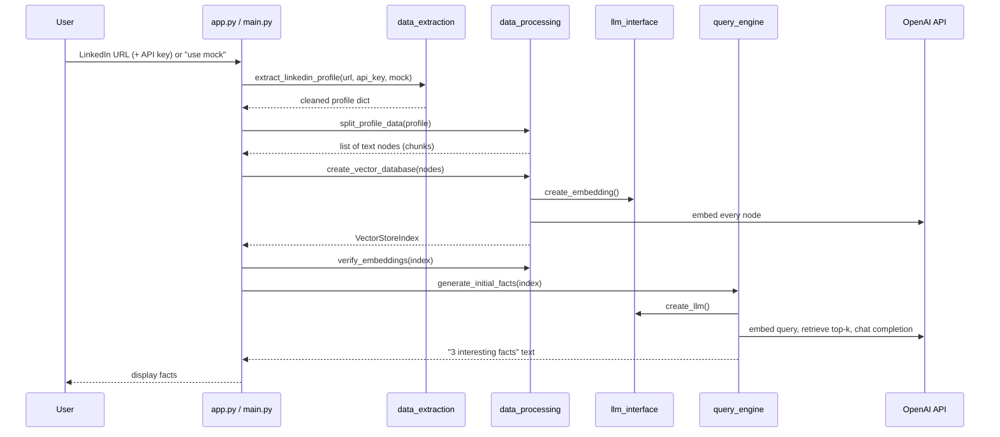
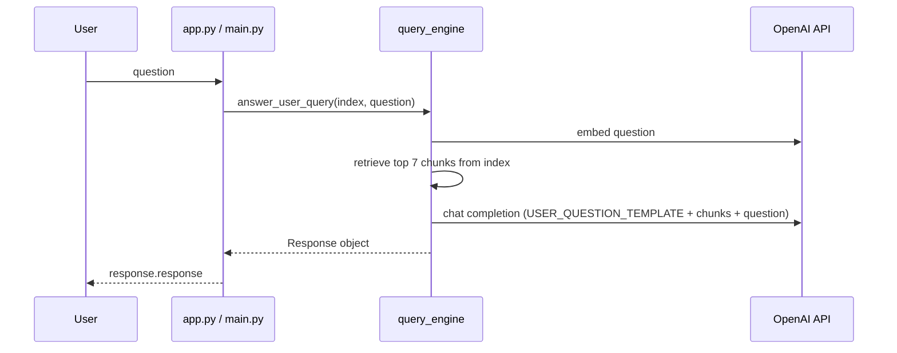

# Architecture

This document explains how the LinkedIn Icebreaker Bot is structured, how data flows through it, and what each program and function does.

## 1. High-Level Overview

The bot is a small **Retrieval-Augmented Generation (RAG)** application:

1. A LinkedIn profile is fetched as JSON (from ProxyCurl or a mock file).
2. The JSON is split into chunks and each chunk is embedded with an OpenAI embedding model.
3. The chunks and embeddings are stored in an in-memory LlamaIndex vector index.
4. For every request (the initial facts, or a user question), the most relevant chunks are retrieved and passed to an OpenAI chat model along with a prompt template.
5. The model's answer is shown in the Streamlit UI (`app.py`) or the terminal (`main.py`).

```
                ┌──────────────────────────┐
                │   app.py  (Streamlit)    │     ┌───────────────────────┐
  User  ──────► │           or             │ ◄── │  config.py            │
                │   main.py (CLI)          │     │  settings + prompts   │
                └────────────┬─────────────┘     └───────────────────────┘
                             │                              ▲
                             ▼                              │ (read by every module)
          ┌─────────────────────────────────────┐           │
          │ modules/data_extraction.py          │ ──► ProxyCurl API / mock JSON URL
          │   extract_linkedin_profile()        │
          └──────────────────┬──────────────────┘
                             │ profile dict
                             ▼
          ┌─────────────────────────────────────┐
          │ modules/data_processing.py          │
          │   split_profile_data()              │
          │   create_vector_database()  ────────┼──► llm_interface.create_embedding()
          │   verify_embeddings()               │         └─► OpenAI embeddings API
          └──────────────────┬──────────────────┘
                             │ VectorStoreIndex
                             ▼
          ┌─────────────────────────────────────┐
          │ modules/query_engine.py             │
          │   generate_initial_facts()  ────────┼──► llm_interface.create_llm()
          │   answer_user_query()               │         └─► OpenAI chat completions API
          └──────────────────┬──────────────────┘
                             │ facts / answer text
                             ▼
                        Shown to user
```

## 2. Request Flow

### 2.1 Processing a profile



### 2.2 Asking a question



## 3. Components

### 3.1 `config.py` — settings and prompts

Central configuration module. Every other module does `import config` and reads values at call time, which is why changing `config.LLM_MODEL_ID` at runtime switches models.

| Group | Settings | Purpose |
|---|---|---|
| OpenAI | `OPENAI_API_BASE`, `CONTEXT_WINDOW` | Endpoint and context size passed to the chat model. The API key itself comes from the `OPENAI_API_KEY` environment variable. |
| Models | `LLM_MODELS`, `LLM_MODEL_ID`, `EMBEDDING_MODEL_ID` | Models offered in the UI, the default chat model (`gpt-5.4-mini`), and the embedding model (`text-embedding-3-small`). |
| Data source | `PROXYCURL_API_KEY`, `MOCK_DATA_URL` | ProxyCurl key (optional) and the URL of the mock profile JSON. |
| Query | `SIMILARITY_TOP_K`, `TEMPERATURE`, `MAX_NEW_TOKENS`, `MIN_NEW_TOKENS`, `TOP_K`, `TOP_P` | Retrieval and generation parameters. Only `SIMILARITY_TOP_K`, `TEMPERATURE` and `MAX_NEW_TOKENS` are used by the current code. |
| Chunking | `CHUNK_SIZE` | Size (in tokens) of each chunk created from the profile. |
| Prompts | `INITIAL_FACTS_TEMPLATE`, `USER_QUESTION_TEMPLATE` | LlamaIndex prompt templates with `{context_str}` (retrieved chunks) and `{query_str}` placeholders. Both instruct the model to answer only from the profile context. |

### 3.2 `modules/data_extraction.py` — getting the profile

**`extract_linkedin_profile(linkedin_profile_url, api_key=None, mock=False) -> dict`**

- **Mock mode:** `GET config.MOCK_DATA_URL` (a static JSON profile hosted by the course). The URL argument is ignored.
- **Live mode:** requires `api_key`; calls `https://nubela.co/proxycurl/api/v2/linkedin` with a Bearer token and parameters asking for skills, inferred salary, personal email and phone number.
- **Cleaning:** on HTTP 200, removes keys whose value is empty (`[]`, `""`, `None`), drops the `people_also_viewed` and `certifications` fields, and removes `profile_pic_url` from each group.
- **Errors:** any failure (bad status, invalid JSON, network error) is logged and an empty dict `{}` is returned, so callers check `if not profile_data`.
- Logs elapsed time at each step.

### 3.3 `modules/data_processing.py` — chunking and indexing

**`split_profile_data(profile_data) -> list[Node]`**
Serialises the profile dict with `json.dumps`, wraps it in a single LlamaIndex `Document`, and splits it with `SentenceSplitter(chunk_size=config.CHUNK_SIZE)`. Returns `[]` on error.

**`create_vector_database(nodes) -> VectorStoreIndex | None`**
Gets the embedding model from `llm_interface.create_embedding()` and builds a `VectorStoreIndex` from the nodes. This is the step that calls the OpenAI embeddings API once per chunk. The index lives in memory only; nothing is written to disk. Returns `None` on error.

**`verify_embeddings(index) -> bool`**
Walks every node ID in the index and checks that the underlying vector store has an embedding for it. Logs a warning for each missing one and returns `False` if any are missing. Callers only log a warning; they do not stop.

### 3.4 `modules/llm_interface.py` — model factories

**`create_embedding() -> OpenAIEmbedding`**
Returns a LlamaIndex `OpenAIEmbedding` for `config.EMBEDDING_MODEL_ID`, using `OPENAI_API_KEY` from the environment.

**`create_llm(temperature, max_new_tokens) -> OpenAILike`**
Returns a chat model for `config.LLM_MODEL_ID`. Details:
- Uses `OpenAILike` rather than LlamaIndex's `OpenAI` class so that any model name is accepted, including newer ones such as `gpt-5.4-mini`.
- For `gpt-5*` models the temperature is forced to `1.0`, because those models only accept the default temperature.
- Sends `max_completion_tokens` through `additional_kwargs` instead of `max_tokens`, because GPT-5 models reject `max_tokens`.

**`change_llm_model(new_model_id)`**
Overwrites `config.LLM_MODEL_ID`. Because `create_llm()` reads the config every time it is called, the next LLM created uses the new model. This is a process-wide change.

### 3.5 `modules/query_engine.py` — generating answers

**`generate_initial_facts(index) -> str`**
Creates an LLM (`max_new_tokens=500`), wraps `config.INITIAL_FACTS_TEMPLATE` in a `PromptTemplate`, builds a query engine from the index (`similarity_top_k=config.SIMILARITY_TOP_K`), and asks for three interesting facts about the person's career or education. Returns the response text, or `"Failed to generate initial facts."` on error.

**`answer_user_query(index, user_query) -> Response`**
Creates an LLM (`max_new_tokens=250`) and a query engine using `config.USER_QUESTION_TEMPLATE`, then runs the user's question through it. Returns the LlamaIndex `Response` object (callers read `.response`). On error it returns the plain string `"Failed to get an answer."`.

### 3.6 `modules/__init__.py` — package exports

Re-exports the public functions of all four modules so they can be imported from `modules` directly.

### 3.7 `app.py` — Streamlit web interface (primary entry point)

Run with `streamlit run app.py`. It calls `load_dotenv()` at start-up so `OPENAI_API_KEY` is read from `.env`.

**`process_profile(linkedin_url, api_key, use_mock, selected_model) -> (facts, index)`**
Runs the full pipeline: optional model switch → extract → split → index → verify → initial facts. Raises `ValueError` with a user-facing message if extraction, splitting or indexing fails.

**`chat_with_profile(index, user_query) -> str`**
Returns a "no profile loaded" message if there is no index; otherwise calls `answer_user_query` and returns `response.response`, or an `Error: ...` string on failure.

**`main()`** — builds the page:
- **Session state:** `index`, `facts` and `messages` live in `st.session_state`, so each browser session keeps its own profile and chat history across Streamlit's reruns.
- **"Process LinkedIn Profile" tab:** a form with URL, ProxyCurl key (password field), "Use Mock Data" checkbox and model dropdown. Submitting runs `process_profile` under a spinner, stores the results and clears the chat history. The right column shows the initial facts.
- **"Chat" tab:** renders the stored message history with `st.chat_message`.
- **Chat input:** `st.chat_input` is placed outside the tabs so it stays pinned at the bottom of the page. A new message is appended, answered via `chat_with_profile`, and `st.rerun()` refreshes the page.

### 3.8 `main.py` — command-line interface (optional)

An alternative entry point that uses the same modules without Streamlit. `app.py` does not import it.

- **`main()`** parses `--url`, `--api-key`, `--mock` and `--model`. If no URL is given it prompts for one, and falls back to mock data when left empty. If live mode has no key, it prompts for the ProxyCurl key.
- **`process_linkedin(url, api_key, mock)`** runs the same pipeline as `process_profile`, prints the three facts, then starts the chat loop.
- **`chatbot_interface(index)`** is a `while True` input loop: shows a short "Bot is typing..." indicator, calls `answer_user_query`, and prints the answer. `exit`, `quit` or `bye` ends it.
- It does **not** call `load_dotenv()`, so `OPENAI_API_KEY` must be set in the shell.

## 4. External Services

| Service | Used by | Purpose | Credential |
|---|---|---|---|
| OpenAI Embeddings API | `create_vector_database`, every query | Embedding profile chunks and queries | `OPENAI_API_KEY` env var / `.env` |
| OpenAI Chat Completions API | `generate_initial_facts`, `answer_user_query` | Generating facts and answers | `OPENAI_API_KEY` env var / `.env` |
| ProxyCurl API | `extract_linkedin_profile` (live mode) | Fetching real LinkedIn profiles | `PROXYCURL_API_KEY` in `config.py` or entered in the UI / CLI |
| Mock data URL (IBM Cloud Object Storage) | `extract_linkedin_profile` (mock mode) | Sample profile JSON | none |

## 5. Design Notes and Known Limitations

- **In-memory index:** each processed profile is re-embedded from scratch; nothing is cached or persisted between runs.
- **Global model setting:** `change_llm_model` changes `config` for the whole Python process, so in Streamlit a model choice made by one user affects everyone using the same server.
- **Duplicate retrieval:** `answer_user_query` retrieves nodes and builds a `context_str` that is never used; the query engine then retrieves again. This costs one extra embedding call per question.
- **Inconsistent error return:** `answer_user_query` returns a plain string on failure, but callers read `.response`. In `app.py` this surfaces as an error message; in `main.py` it ends the chat loop.
- **Unused settings:** `MIN_NEW_TOKENS`, `TOP_K` and `TOP_P` in `config.py` are not used by the current code.
- **ProxyCurl availability:** live extraction depends on the ProxyCurl API being available; mock mode works without it.
